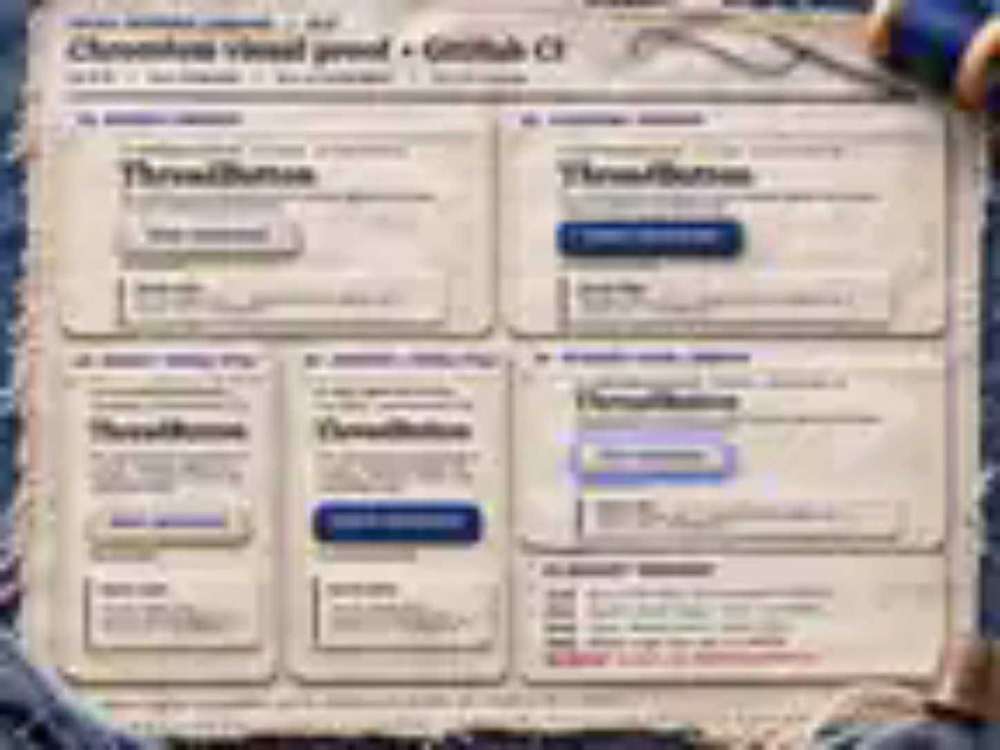

# ThreadButton — visual target, material assets and review contract

**Status: implementation candidate; visual-fidelity acceptance OPEN.**

This image is a **real downsampled copy** of the user-approved 1448 × 1086
image-generated material reference, NOT a screenshot of the runnable implementation.
The image originally came from the active design conversation. The full-resolution
PNG has SHA-256:
`4602a4d210b52a6382ef38645f18235cdb6eaa220c0342c69f1833fa6fa06337`.
The embedded WebP preview was reduced to 144 × 108 and has SHA-256
`0e353995609cc43a592b5a595e6c2e23269dd3fd5afd7d5616dc934acbd46a72`.
Use the full-resolution version for any pixel-level artistic comparison; the
repo-embedded preview is for navigation and provenance, not fiber-level inspection.

## Source-to-render map

| Reference cue | Implemented asset / code | Limitation |
| --- | --- | --- |
| Cream open-weave linen with visible warp and weft | [linen-weave.svg](assets/linen-weave.svg), [textile-material.css](textile-material.css) | Procedural weave; no scanned fiber displacement |
| Deep indigo woven fabric | [indigo-yarn.svg](assets/indigo-yarn.svg), committed-state CSS | Approximate yarn lighting, not anisotropic micro-BRDF |
| Raised stitched fabric board, inlaid patches and seams | `.fabric-board`, `.specimen-panel`, pseudos and layered shadows | Shadows are illustrative |
| Loose and committed padded buttons | `.tactile-button` and generated `--til-*` parameters | No physical cloth deformation |
| Keyboard focus with preserved semantics | Actual native `button`, `aria-pressed`, stable name, focus ring | Static focus patch is only a specimen |
| 375px mobile material studies | Responsive panel layouts | Actual mobile browser receipt is still required |

Main page: [index.html](index.html).
The generated CSS and `textile.tokens.json` are *not* edited by this visual layer.

## Reviewer acceptance gates (do not infer from passing CI)

- [ ] View the **full-resolution original** and fresh Chromium capture side-by-side
  at identical viewport/zoom; reject if woven yarn strands read as a flat pattern.
- [ ] Confirm thread crossings, fiber fuzz, seam height, thick padded stitching,
  and realistic microshadows are visually legible on both linen and indigo.
- [ ] Confirm interactive loose and committed states feel mechanically different,
  yet the control label stays stable for assistive technology.
- [ ] Verify surface textures actually load at the real deployed URL; test 1440px
  desktop and 375px mobile, pointer, keyboard, touch and reduced motion.
- [ ] Evaluate actual fiber realism at 200% zoom: currently modeled with SVG
  procedural texture, not photogrammetry, real yarn geometry or calibrated cloth.
- [ ] Review the GitHub Actions source- and screenshot-hash receipts on the
  **new exact commit**, not historical runs.

### Bounds

The image reference is a **visual target**, not proof of renderer implementation.
The existing 17-check Chromium suite proves certain behavior and rendering
mechanics, not physical material fidelity. This PR should stay open for subjective
material QA and hosted smoke testing before any photorealism or release claims.
